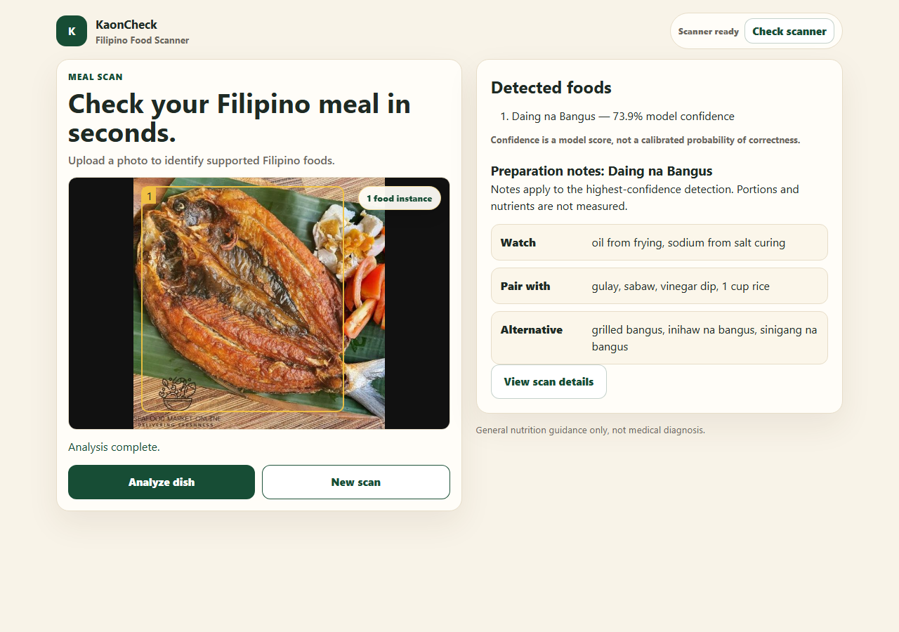
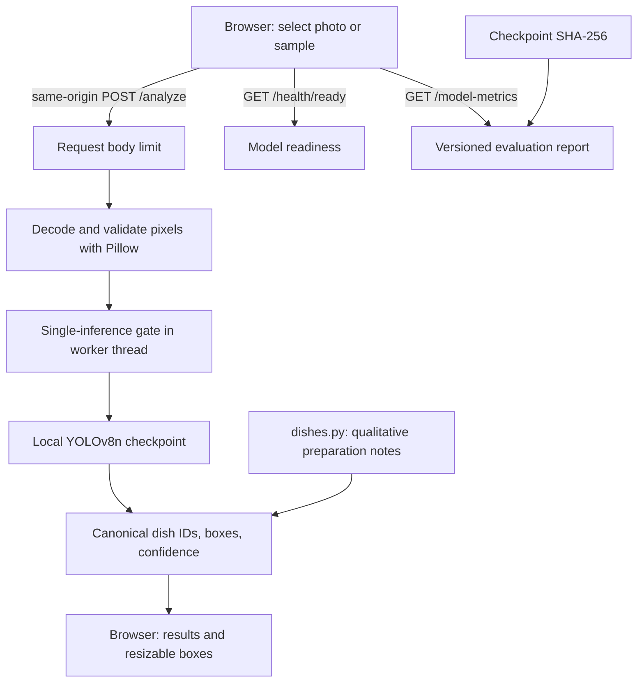

# KaonCheck

Identify 11 Filipino food classes from photos using a local YOLOv8n model.

KaonCheck analyzes uploaded food photos and displays detected dishes, bounding boxes, confidence scores, and general preparation notes. A FastAPI backend runs the model locally, while a plain HTML/CSS/JavaScript interface handles uploads and results. CPU inference is supported; no API key or external AI service is required.



*The included sample is a dataset example, not independent evaluation evidence.*

## Setup

Tested on **Windows with Python 3.12**. From a checkout of this repository, run these four PowerShell commands:

```powershell
python -m venv .venv
.\.venv\Scripts\Activate.ps1
python -m pip install -r requirements.lock
python -m uvicorn main:app --host 127.0.0.1 --port 8000
```

Open [the local app](http://127.0.0.1:8000), select **Try sample**, then **Analyze dish**. Open **View scan details** to inspect predictions and the limitations of the recorded validation results. **New scan** clears the photo and cancels pending browser requests.

If PowerShell blocks activation, invoke `.venv\Scripts\python.exe` directly in the last two commands; changing the machine's execution policy is unnecessary. The lock files and CI currently target Windows/Python 3.12; other platforms have not been verified. Installation downloads Python packages, including PyTorch. Once installed, inference and the UI require no external network connection.

The ~6 MB trained checkpoint is included in `models/`, with its SHA-256 checked at startup. The training dataset is not required to run the demo. If the scanner is unavailable, inspect the server logs and [readiness endpoint](http://127.0.0.1:8000/health/ready), then select **Check scanner**. The page remains available when model loading fails.

## Features

- JPEG, PNG, and WebP uploads, with preview, EXIF orientation handling, and an attributed example.
- Instance-level detections: repeated instances are retained; numbered boxes follow image resizing.
- Model confidence and end-to-end model-call timing, separate from dataset evaluation metrics.
- Preparation notes for the highest-confidence dish, explicitly labelled as general rules.
- Bounded request/image sizes, decoded-pixel inference, serialized model access, and useful HTTP errors.
- Request timeouts, reset cancellation, keyboard photo selection, and a native accessible details dialog.
- Versioned checkpoint/evaluation evidence, API tests, real-model Chromium tests, and GitHub Actions checks.

The shipped v1 is **upload-only**. Live camera scanning, conversational chat, numerical health scores, portion estimation, and explainability maps are outside its scope.

## Stack and architecture

Python 3.12, FastAPI/Uvicorn, Ultralytics YOLOv8n/PyTorch, Pillow, and plain HTML/CSS/JavaScript. Development tools: unittest, HTTPX, Playwright Chromium, and Ruff. Node is used only to check JavaScript syntax.



`main.py` owns HTTP routes and model lifecycle. `request_limits.py` bounds bodies before multipart parsing. `settings.py` reads environment-backed configuration. `dishes.py` maps the eleven supported identities to general preparation notes. Browser rendering uses text nodes for result content. Static serving permits only explicit public assets.

Uploaded files are decoded in memory by the handler and are not retained by application code. The multipart library may temporarily spool uploads before decoding. The server does not keep scan history, accounts, or a database. Browser object URLs are revoked when a scan is cleared or replaced.

## Configuration

No credentials are required. Defaults work without an `.env` file. To override them, copy `.env.example` to `.env`, edit it, and append `--env-file .env` to the uvicorn command. Environment paths resolve relative to the application directory.

| Variable | Default | Meaning |
|---|---|---|
| `KAONCHECK_MODEL_PATH` | `models/kaoncheck.pt` | Trusted local checkpoint; the bundled path is checksum-verified. |
| `KAONCHECK_MAX_UPLOAD_BYTES` | `10485760` | 10 MiB maximum image payload. |
| `KAONCHECK_MAX_IMAGE_PIXELS` | `20000000` | Maximum decoded width × height. |
| `KAONCHECK_CONFIDENCE` | `0.25` | Detection score threshold, greater than 0 and at most 1. |

The complete HTTP body is capped at the upload limit plus 64 KiB for multipart overhead. Model access permits one inference at a time per process and returns **429** when busy. A browser abort stops waiting for a result; it does not interrupt an already-running PyTorch call. Use only checkpoints you trust. A custom checkpoint must contain the same eleven supported classes; its metrics are unavailable unless a matching report exists.

## API

| Endpoint | Behavior |
|---|---|
| `GET /health/ready` | 200 with model/class readiness and upload limit; 503 if unavailable. |
| `POST /analyze` | Multipart `file`; canonical dish/instance IDs, percentage model scores, normalized `x1,y1,x2,y2` boxes, notes, and model-call time in ms. |
| `GET /model-metrics` | Checkpoint-linked legacy validation report; 503 for absent or mismatched evidence. |

An empty detection list is a successful analysis. Invalid/unsupported images return 422/415; size violations 413; busy inference 429; unavailable model 503; failed inference 500 with server-side logging and a generic public message. Filename extensions never become inference source paths.

## Tests and checks

With the virtual environment active:

```powershell
python -m pip install -r requirements-dev.lock
python -m playwright install chromium
python -m ruff check .
node --check app.js
python -m unittest discover -s tests -v
python -m unittest discover -s tests/browser -v
```

There are **17 API/startup/security tests and 9 Chromium tests**. Browser tests start and stop their own local server on an available port, use the bundled model for photo and blank-image inference, and block external requests. Intercepted responses exercise busy/unavailable services, timeouts, delayed responses after reset, and missing evaluation data. They also cover keyboard focus, mobile width, and box rendering. Local screenshots and logs go into ignored `.artifacts/`.

[GitHub Actions](.github/workflows/checks.yml) runs the same checks on Windows/Python 3.12 and uploads browser artifacts. There is no application compilation step beyond installing the Python dependencies; JavaScript runs directly in the browser.

## Model and evaluation evidence

The bundled YOLOv8n checkpoint came from `runs/detect/kaoncheck-4/weights/best.pt`. Its recorded training metrics match epoch **86** of a **100-epoch** run. Its metrics and checksum are recorded in [the evaluation report](docs/model-evaluation.json). F1 below is the harmonic mean of reported precision and recall.

| Legacy validation metric | Score |
|---|---:|
| Precision | 97.37% |
| Recall | 92.89% |
| F1 | 95.08% |
| mAP50 | 97.05% |
| mAP50–95 | 78.54% |

**These figures are exploratory, not independent test performance.** Exact-byte hashing found 108 cross-split duplicate groups: 55 validation images match training images, and 53 test images match training or validation. Near-duplicates and related capture sequences have not been screened. The checkpoint has not been retrained on corrected splits. They do not establish production accuracy or a per-photo correctness probability.

The original export contains 5,969 training, 746 validation, and 746 test images. To reproduce the exact-byte overlap audit with the local dataset present:

```powershell
python tools/audit_dataset.py dataset
```

[Training history](docs/results/training-results.png), [precision-recall chart](docs/results/precision-recall-curve.png), and [confusion matrix](docs/results/confusion-matrix.png) are retained as legacy artifacts with those same caveats. The report includes checkpoint and dataset-configuration hashes. Replacing weights does not automatically regenerate evaluation evidence.

Supported classes: Adobong Iga, Chicken Inasal, Fried Chicken, Daing na Bangus, Pan Fried Tilapia, Sinaing na Tulingan, Breaded Pork Chop, Lechon Kawali, Pork Bistek, Boiled Rice, Fried Rice.

## Dataset and attribution

The local export identifies itself as **Filipino Food Datasets, v1 80-10-10 Set**, exported April 21, 2026, and records **CC BY 4.0**:

- [Local export's Roboflow project](https://universe.roboflow.com/earls-workspace-khccb/filipino-food-datasets-kd7d6-z8qui).
- [Upstream Dataset for Filipino Dishes project](https://universe.roboflow.com/dataset-for-filipino-dishes/filipino-food-datasets-kd7d6).

Display names normalize the original category-wrapped labels. The dataset itself is excluded from Git. Attribution describes the available export metadata; training-image provenance and annotation quality still need review before stronger evaluation claims.

### Included artifacts

- **Checkpoint:** `models/kaoncheck.pt` is the trained `kaoncheck-4/weights/best.pt` checkpoint. Its SHA-256 is `df93cfc38df2865b5f56df15fb42f4c5ab4721adb306579ff776ca420973f91e` and is also recorded in `models/kaoncheck.sha256`.
- **Sample photo:** `samples/daing-na-bangus.jpg` is an unchanged validation image from the export above. Original filename: `117951438_224458422565933_2250798917678993588_n_jpg.rf.5ca8b7d041d91b0c99a03d6773bf9d0d.jpg`. SHA-256: `cc5a7468aee8d7c567a0fbeb8d8bd93c617069490f9f90a7352a9f452eee1894`. Its attribution and CC BY 4.0 license follow the dataset export metadata.

## Optional training

Training requires your own local dataset YAML and trusted YOLOv8n base weights. CPU is the default; a CUDA device can be selected explicitly:

```powershell
python train.py --data dataset/data.yaml --weights yolov8n.pt --device cpu --name kaoncheck
```

The script uses 100 epochs, 640-pixel training images, and batch size 16 by default. New runs go under `runs/detect/` and do not overwrite the demo checkpoint or evaluation report. To establish trustworthy new results, first correct/screen splits, then retrain, evaluate a justified held-out set, and publish corresponding artifact hashes and configuration. Training is optional and is not part of application setup.

## Known limitations and next work

- Recognition covers eleven classes. Unsupported foods may be missed or incorrectly assigned a known label; confidence is not calibrated and there is no reliable out-of-distribution rejection.
- Dataset split leakage prevents independent generalization claims. Screening related images and retraining is the first substantive ML improvement.
- Preparation notes are unvalidated heuristics. Ingredients, portions, allergens, calories, nutrients, and clinical suitability cannot be established from this output.
- One process permits one inference at a time; multiple workers have separate models and locks. Public hosting requires access and resource controls at the hosting boundary.
- Automated browser coverage is Chromium on Windows. Other platforms, browsers, and assistive technologies require verification.

## Deployment

The application currently runs locally. For a hosted deployment:

- [ ] Use Python 3.12, install `requirements.lock`, and verify the bundled checkpoint checksum.
- [ ] Measure CPU inference latency, startup time, and memory on the target host.
- [ ] Start with one Uvicorn worker; additional workers load separate models and have independent inference gates.
- [ ] Serve the frontend and API from the same HTTPS origin.
- [ ] Configure request-rate and connection limits at the proxy/hosting boundary. The application has no authentication or per-user quotas.
- [ ] Align proxy body limits with the image limit plus multipart overhead, and assess latency against the browser's 30-second timeout.
- [ ] Use `/health/ready` for readiness probes and keep environment configuration outside Git.
- [ ] Run the checks above and verify valid, invalid, oversized, busy, and no-detection requests on the deployed host.
- [ ] Confirm `/static/.env` and `/static/.git/HEAD` return 404. Review logging, temporary multipart-file handling, and applicable dataset/model/package licenses.
- [ ] Record the deployed commit, checkpoint hash, configuration, and rollback procedure.

## Next steps

The first priority is screening exact/near-duplicate images, correcting dataset splits, retraining, and evaluating a genuinely held-out set. Further work could evaluate calibrated thresholds and unsupported-food rejection. Camera capture, grounded chat, and detector explanations would each require their own validation before inclusion.
